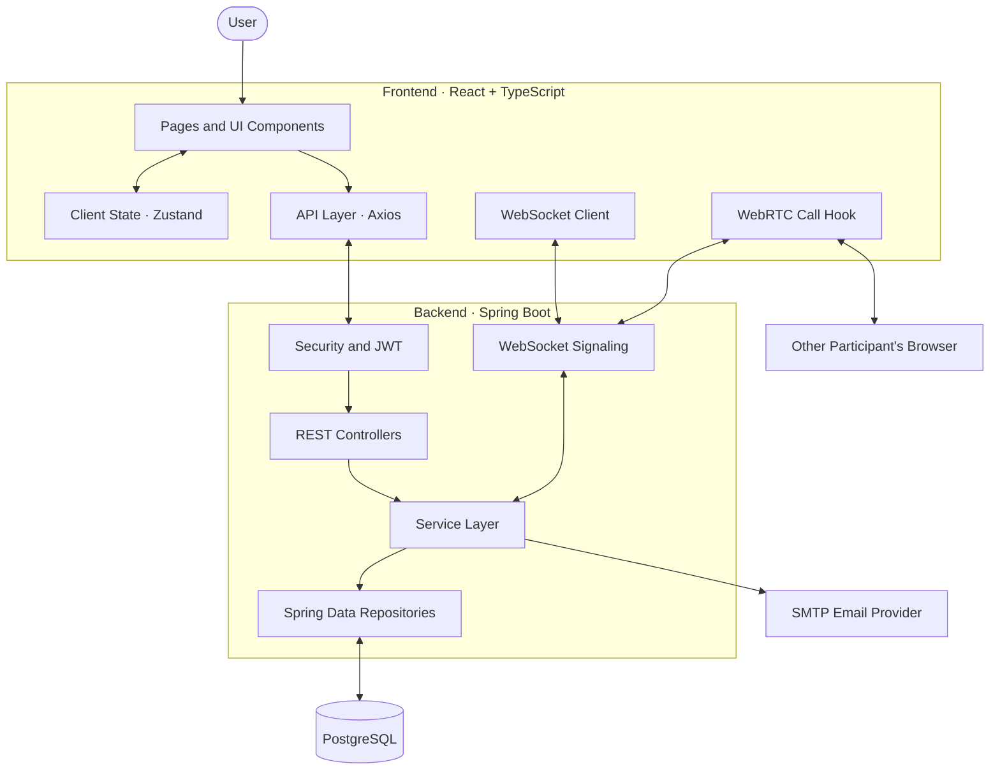
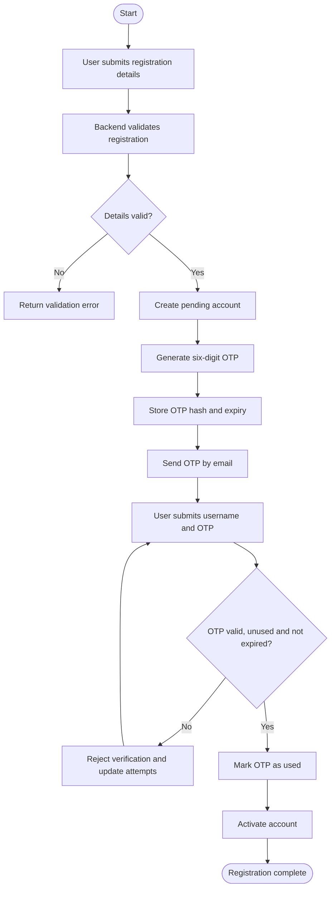
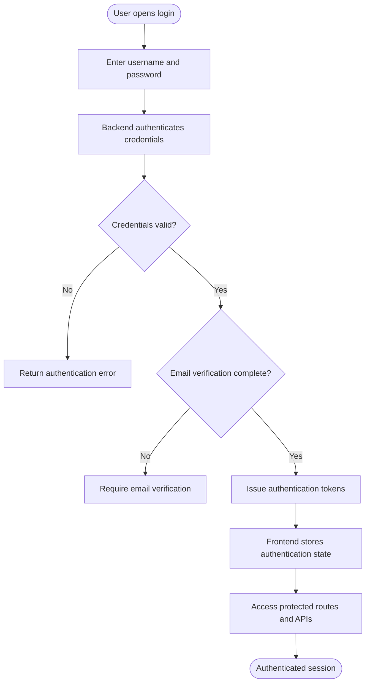
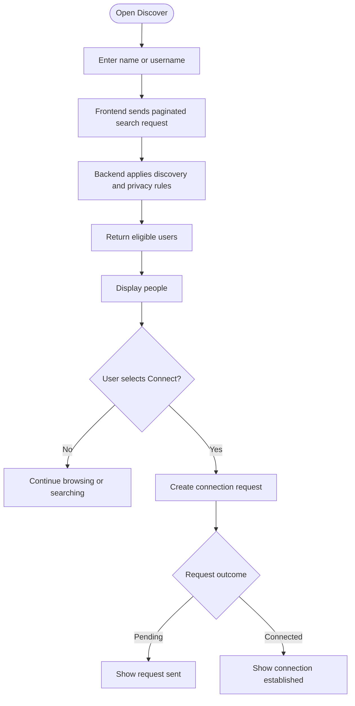
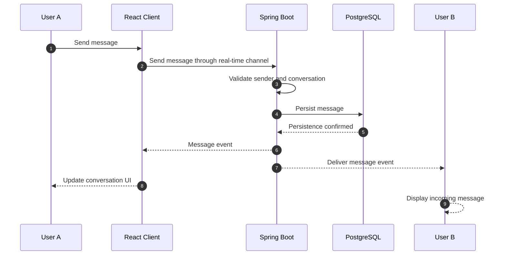
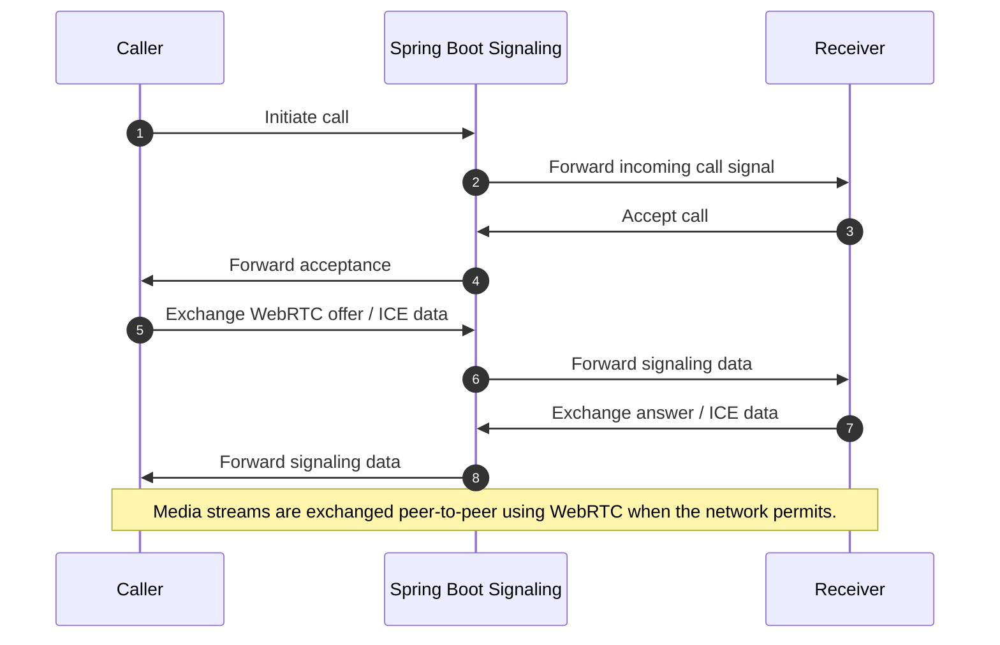

<div align="center">

# VibeCircle

### Find Your People. Find Your Vibe. 🤎

A full-stack social networking application for discovering people, building meaningful connections, sharing moments, and communicating in real time.

<br />


**Discover · Connect · Share · Chat · Call**

</div>

---

## ✨ Overview

**VibeCircle** is a social networking platform built around a simple idea: meaningful connections begin when people find others who share their interests.

Users can create an account, verify their email, build a profile, discover people across the platform, send and manage connection requests, share stories and posts, and communicate through real-time messaging and audio/video calls.

The application uses a React + TypeScript frontend and a Java Spring Boot backend backed by PostgreSQL.

> **Project status:** Core social networking workflows are implemented. Communities currently remains a frontend prototype.

---

## 📌 Table of Contents

- [Features](#-features)
- [Application Preview](#-application-preview)
- [Technology Stack](#-technology-stack)
- [System Architecture](#-system-architecture)
- [Application Flows](#-application-flows)
- [Repository Structure](#-repository-structure)
- [Getting Started](#-getting-started)
- [Configuration](#-configuration)
- [Database and Migrations](#-database-and-migrations)
- [Security and Privacy](#-security-and-privacy)
- [Testing](#-testing)
- [Troubleshooting](#-troubleshooting)
- [Future Improvements](#-future-improvements)

---

## 🚀 Features

### 🔐 Authentication and Account Management
- User registration and login.
- Six-digit email OTP verification.
- OTP expiration and attempt-limit handling.
- JWT-based authentication.
- Username-based login.
- Support for multiple accounts using the same email address.
- Protected application routes.

### 👤 Profile Management
- Create and update a personal profile.
- Add profile information, interests, and location.
- Configure profile visibility and discovery preferences.
- Control who can send connection requests.

### 🌍 Global People Discovery
- Search discoverable users across the platform.
- Search by name or username.
- Browse paginated discovery results.
- Discover people without requiring the same city or shared interests.
- Respect profile visibility, discoverability, blocks, existing connections, and pending requests.

### 🤝 Connections
- Send connection requests.
- Accept or reject incoming requests.
- Cancel sent requests.
- Remove existing connections.
- View friends, incoming requests, and sent requests.

### 💬 Messaging
- One-to-one conversations.
- Real-time communication using WebSockets.
- Conversation history and message interface.

### 📖 Stories and Social Sharing
- Create and view stories.
- Social feed and post interactions.
- Commenting on posts.

### 📞 Audio and Video Calls
- Audio/video calling interface.
- WebRTC-based peer-to-peer media communication.
- Call signaling through the application backend.

### 🔔 Notifications
- Dedicated notifications interface for social activity.

### 👥 Communities
- Community browsing and detail screens are currently available as a **frontend prototype**.
- Community functionality is not represented as a completed backend workflow.

---

## 🖥️ Application Preview

Add screenshots of the running application here. A suggested layout:

| Landing Page | Dashboard |
|---|---|
| `` | `` |

| Discover People | Messaging |
|---|---|
| `` | `` |

Create the `docs/screenshots/` directory and add your own screenshots. Update the image paths above to match the filenames you use.

---

## 🧰 Technology Stack

| Layer | Technologies |
|---|---|
| Frontend | React, TypeScript, Vite |
| UI and styling | Tailwind CSS, CSS |
| Client-side routing | React Router |
| HTTP communication | Axios |
| Client state | Zustand |
| Icons | Lucide React |
| Backend | Java, Spring Boot |
| Persistence | Spring Data JPA / Hibernate |
| Database | PostgreSQL |
| Authentication | Spring Security, JWT |
| Email verification | Spring Boot Mail, Gmail SMTP configuration |
| Real-time messaging | WebSockets |
| Audio/video communication | WebRTC |
| Database migrations | Flyway |
| Build tools | npm, Maven |
| Version control | Git and GitHub |

---

## 🏗️ System Architecture

VibeCircle follows a client-server architecture. The frontend handles presentation and user interactions, while the backend owns business rules, authentication, authorization, persistence, and real-time communication.



### Request lifecycle

1. A user performs an action in the React interface.
2. The frontend API layer sends an HTTP request to the backend.
3. Security filters validate the authentication context.
4. The controller receives the request and delegates application logic to a service.
5. The service applies business rules and calls the relevant repository.
6. Spring Data JPA communicates with PostgreSQL.
7. The backend returns a response to the frontend.

---

## 🔄 Application Flows

### 1. Registration and Email OTP Verification



### 2. Login and Protected Access



### 3. Global People Discovery and Connection Requests



### 4. Real-Time Messaging



### 5. Audio and Video Calling



---

## 📂 Repository Structure

The repository is organized as a Spring Boot backend with the React application inside `frontend/`.

```text
VibeCircle/
│
├── frontend/
│   ├── public/
│   │   ├── favicon.svg
│   │   └── icons.svg
│   │
│   ├── src/
│   │   ├── api/                    # HTTP APIs and real-time clients
│   │   ├── assets/                 # Static frontend assets
│   │   ├── components/
│   │   │   ├── auth/               # Authentication components
│   │   │   ├── calls/              # Audio/video call UI
│   │   │   ├── dashboard/          # Feed, stories, comments, navigation
│   │   │   └── layout/             # Shared layouts
│   │   ├── hooks/                  # Reusable React hooks
│   │   ├── pages/                  # Application pages
│   │   ├── store/                  # Client-side state
│   │   ├── styles/                 # Theme and design styles
│   │   ├── App.tsx                 # Application routes and composition
│   │   └── main.tsx                # Frontend entry point
│   │
│   ├── package.json
│   ├── package-lock.json
│   ├── tsconfig.json
│   └── vite.config.ts
│
├── src/
│   ├── main/
│   │   ├── java/com/vibecircle/
│   │   │   ├── account/            # Account-related functionality
│   │   │   ├── auth/               # Authentication, OTP and JWT
│   │   │   ├── discovery/          # Global people discovery
│   │   │   ├── ops/                # Operational functionality
│   │   │   ├── ratelimit/          # Rate limiting
│   │   │   ├── user/               # User and profile functionality
│   │   │   └── ...                # Other feature packages
│   │   │
│   │   └── resources/
│   │       ├── db/migration/       # Flyway SQL migrations
│   │       ├── application.properties
│   │       └── application-prod.properties
│   │
│   └── test/
│       └── resources/
│           └── application-test.properties
│
├── pom.xml                         # Maven backend configuration
└── README.md
```

The tree highlights the main application areas rather than every Java class. Additional backend feature packages are kept under `src/main/java/com/vibecircle/`.

---

## ⚙️ Getting Started

### Prerequisites

Install the following before running the application:

- Git
- JDK version compatible with the project's `pom.xml`
- Maven (or use the Maven Wrapper if available)
- Node.js and npm compatible with the frontend dependencies
- PostgreSQL

### 1. Clone the repository

```bash
git clone https://github.com/RitikaSinha19/VibeCircle.git
cd VibeCircle
```

### 2. Configure PostgreSQL

Create a PostgreSQL database for the application.

```sql
CREATE DATABASE vibecircle;
```

Configure the database URL, username, and password through your local Spring Boot configuration or environment variables.

### 3. Configure environment variables

Set the values required by your local configuration. At minimum, the email and JWT settings include:

```env
JWT_SECRET=replace-with-a-long-random-secret
MAIL_USERNAME=your-email@gmail.com
MAIL_PASSWORD=your-gmail-app-password
```

Also configure the PostgreSQL connection details expected by `application.properties`.

**Never commit real passwords, app passwords, private keys, or production secrets.**

For Gmail SMTP, use a Google App Password where applicable. Do not use your regular Google account password.

### 4. Run the backend

Open a terminal at the repository root:

```bash
mvn spring-boot:run
```

The backend's default local address is:

```text
http://localhost:8080
```

If your environment uses a Maven Wrapper, you can run:

```bash
./mvnw spring-boot:run
```

On Windows:

```cmd
mvnw.cmd spring-boot:run
```

### 5. Run the frontend

Open a second terminal:

```bash
cd frontend
npm install
npm run dev
```

Vite's default local address is:

```text
http://localhost:5173
```

If the frontend API base URL is configurable in your environment, point it to the backend address.

### 6. Build the frontend

From the `frontend/` directory:

```bash
npm run build
```

---

## 🗄️ Database and Migrations

VibeCircle uses PostgreSQL for persistent application data and Flyway for schema versioning.

Migration scripts are stored in:

```text
src/main/resources/db/migration/
```

Known migrations include:

| Migration | Purpose |
|---|---|
| `V4__allow_duplicate_emails.sql` | Removes the unique email index to support multiple accounts sharing an email address |
| `V5__add_otp_attempts.sql` | Adds OTP attempt tracking to verification tokens |

Flyway applies pending migrations when the backend starts, according to the configured application settings.

For a fresh local database, use the project's complete migration history. Do not apply only the latest migration scripts to an empty database.

---

## 🔒 Security and Privacy

Security is part of the application flow, not an afterthought.

- JWT-based authentication for protected backend resources.
- Email verification through time-limited OTPs.
- OTP hashes are stored instead of relying on plaintext OTP persistence.
- OTP attempt tracking helps limit repeated verification attempts.
- Username-based login keeps login identifiers unambiguous when email addresses are shared by multiple accounts.
- Discovery respects user visibility and discoverability preferences.
- Existing connections, pending requests, and blocked relationships are considered by discovery rules.
- Secrets should be supplied through environment variables and excluded from version control.

**Deployment checklist**

- Replace development JWT secrets with strong production secrets.
- Use HTTPS for production traffic.
- Restrict CORS to trusted frontend origins.
- Use a production database account with least-privilege access.
- Keep SMTP credentials and database passwords outside source control.
- Configure production logging without exposing tokens or personal data.

---

## 🧪 Testing

Run backend tests from the repository root:

```bash
mvn test
```

Run a frontend production build:

```bash
cd frontend
npm run build
```

Recommended end-to-end verification:

- Register a new account and verify its email OTP.
- Log in with the username and password.
- Update profile details and privacy preferences.
- Search for users by name and username.
- Send, accept, reject, and cancel connection requests.
- Verify that connected, blocked, and non-discoverable users are handled correctly.
- Send messages between two accounts.
- Test story and post interactions.
- Test audio/video call permissions, acceptance, and hang-up.
- Verify behavior after refreshing the browser or losing network connectivity.

---

## 🧩 Troubleshooting

| Problem | What to check |
|---|---|
| Backend cannot connect to PostgreSQL | Database is running; URL, username, and password are correct |
| Email OTP is not delivered | `MAIL_USERNAME`, `MAIL_PASSWORD`, Gmail App Password, and SMTP settings |
| JWT authentication fails | `JWT_SECRET`, token expiry, and frontend token handling |
| Frontend cannot reach backend | API base URL, backend status, and CORS configuration |
| Port `8080` is already in use | Stop the other process or configure another backend port |
| Flyway migration fails | Database state and migration version history |
| WebSocket connection fails | Backend availability, endpoint configuration, and proxy settings |
| Audio/video call has no media | Browser permissions, HTTPS/localhost context, and network connectivity |

---

## 🛣️ Future Improvements

Potential areas for continued engineering:

- Automated end-to-end testing.
- More comprehensive API documentation.
- CI checks for backend tests and frontend builds.
- Production deployment and monitoring.
- Improved media storage and delivery.
- Additional real-time scalability and reliability work.
- Completing backend-powered Communities functionality.

---

## 🤝 Contributing

Contributions, suggestions, and bug reports are welcome.

1. Fork the repository.
2. Create a feature branch.
3. Make focused changes.
4. Run the relevant tests and builds.
5. Open a pull request describing the change.

---

## 👩‍💻 Author

**Ritika Sinha**

Built as a full-stack software engineering project with a focus on backend development, real-time communication, authentication, and modern frontend architecture.

- GitHub: [@RitikaSinha19](https://github.com/RitikaSinha19)
- Project: [VibeCircle](https://github.com/RitikaSinha19/VibeCircle)

---

<div align="center">

### Find Your People. Find Your Vibe. 🤎

*Built with curiosity, persistence, and a lot of code.*

[⬆ Back to top](#vibecircle)

</div>
